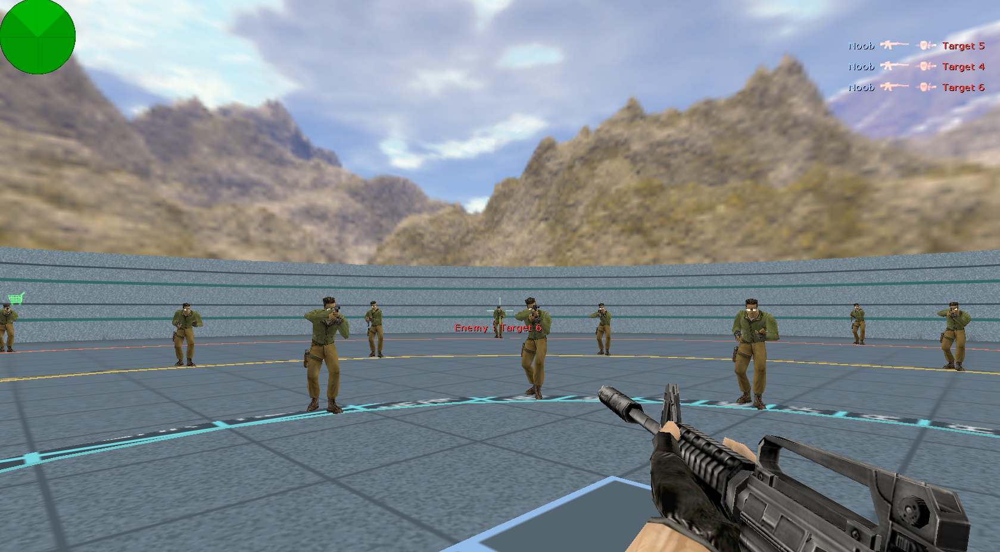
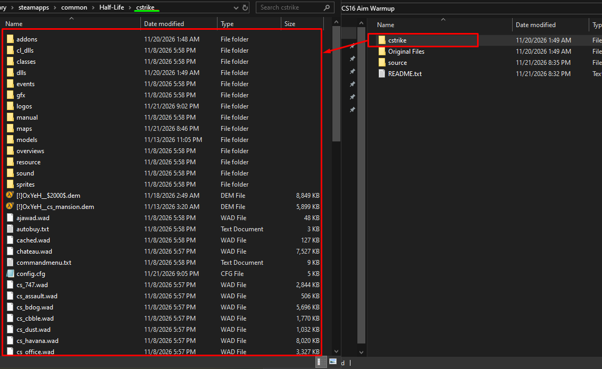
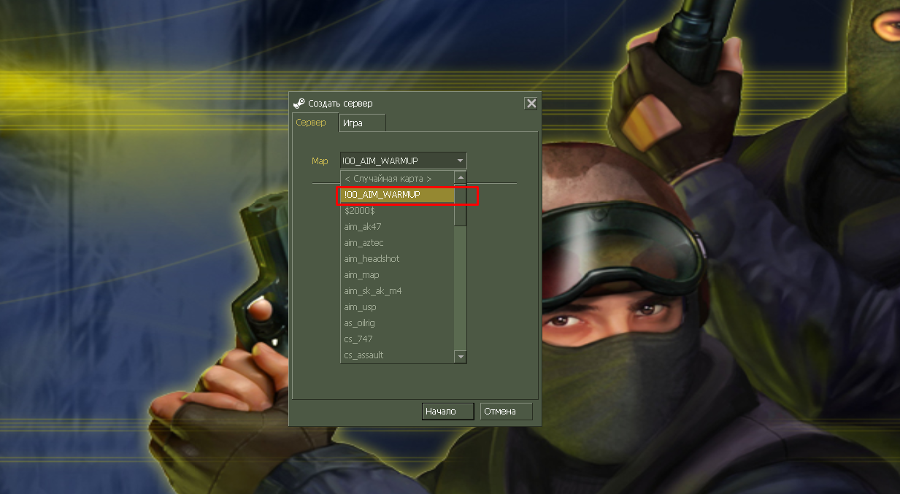
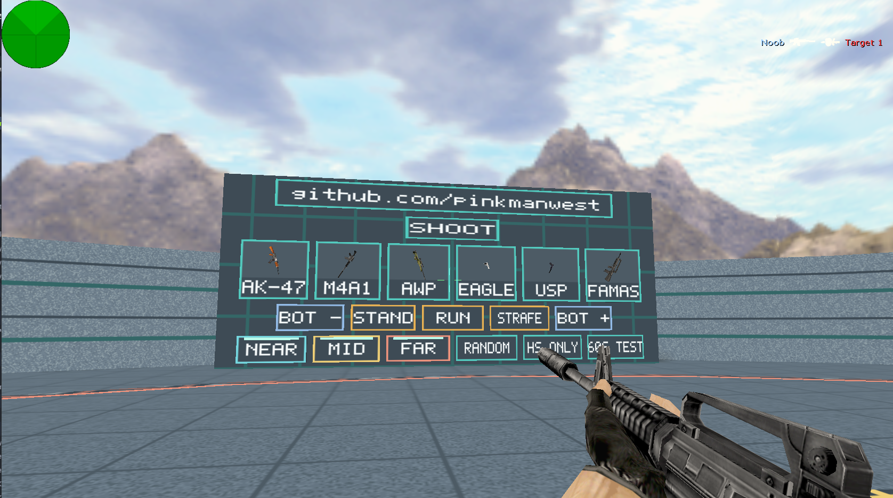
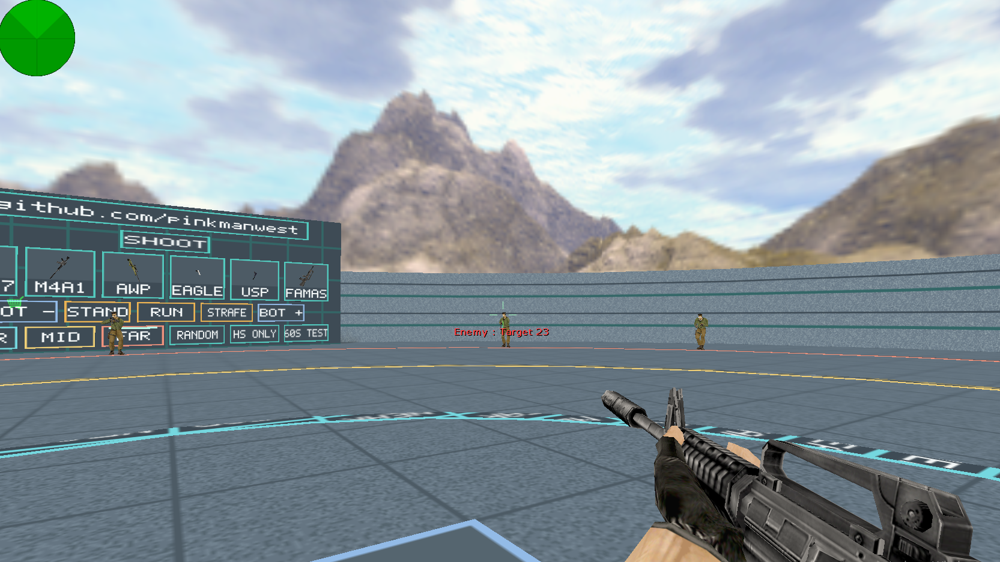

# CS 1.6 Aim Warmup

[Русский](README.md) · [English](README.en.md)

[Release page and downloads](https://github.com/pinkmanwest/cs16-warmup/releases/tag/v4.5) · [Installation](#installation) · [Controls](#controls)

A circular warmup map for the Steam version of Counter-Strike 1.6 on Windows. It has up to 31 targets across three distances, fast respawns, unlimited ammo, and a shoot-to-select weapon board. Start it from **New Game** in CS 1.6.

## Installation

1. Click **Download ZIP for Windows** at the top of this page. On the release page, open **Assets** and choose `CS16-Aim-Warmup-v4.5-Windows.zip`. The automatic `Source code` archives contain the project source files.
2. Close CS 1.6. In your Steam Library, right-click **Counter-Strike** and choose **Manage** → **Browse local files**. This opens the `Half-Life` folder, which already contains a `cstrike` folder.
3. Copy your existing `cstrike` folder somewhere safe. This backup lets you restore your original setup.
4. Extract the downloaded ZIP. Copy the included `cstrike` folder into `Half-Life` so Windows merges the two `cstrike` folders. If prompted, choose **Replace the files in the destination**. The map should end up at `Half-Life\cstrike\maps\!00_AIM_WARMUP.bsp`.
5. Launch CS 1.6. Select **New Game**, choose `!00_AIM_WARMUP`, and set the player limit to **32**. Click **Start** and choose CT or T.

## Controls

You start with an AK-47, a USP, and a knife. Press `2` for your pistol and `3` for your knife. Shoot a panel on the board to select a weapon, or walk up to it and press `E`. Choose from the AK-47, M4A1, AWP, Desert Eagle, USP, and FAMAS. Magazines have unlimited ammo. Press `M` to open the team menu.

| Board button | What it does |
| --- | --- |
| `NEAR`, `MID`, `FAR` | Toggle the near, middle, and far rings independently. Lit strips show which rings are active. |
| `BOT −` / `BOT +` | Remove or add one bot across the active rings. |
| `STAND` | Keep bots at their starting spots. |
| `RUN` | Make bots run around their rings. |
| `STRAFE` | Make bots move sideways, reverse direction, and pause briefly. |
| `RANDOM` | Respawn each bot at a random point on its own ring. |
| `HS ONLY` | Only headshots damage bots. |
| `60S TEST` | Start a personal 60-second test that reports kills, headshots, and accuracy. |

There is no freeze time. The round timer starts at 30 minutes. Bots respawn in about 0.3 seconds.

## Troubleshooting

**The map is missing from the list.** Check that `!00_AIM_WARMUP.bsp` is in `Half-Life\cstrike\maps`. If the path contains `cstrike\cstrike`, move the contents of the inner folder up one level. Fully restart the game.

**The map loads but there are no bots.** Make sure you copied the complete `cstrike` folder from the ready-to-play ZIP, including `addons` and `dlls`. Set the player limit to 32 and check that at least one ring button is lit.

**Restore your original setup.** Close CS 1.6, rename the modified `cstrike` folder, and restore your backup under the name `cstrike`.

## Source files and dependencies

The [source](source/) directory contains the Pawn plugin source, the editable GoldSrc map and texture WAD, the map generator, and the texture embedder. Use the [build instructions](source/BUILD.md#english) to rebuild the map and plugin. The map uses models and a skybox from the installed copy of CS 1.6.

[Download the project source ZIP](https://github.com/pinkmanwest/cs16-warmup/releases/download/v4.5/CS16-Aim-Warmup-v4.5-Project-Source.zip)

The build uses AMX Mod X, Metamod-R, and ReGameDLL_CS. See [THIRD-PARTY.md](THIRD-PARTY.md) for exact versions, licenses, and links to the source code.

A project by [pinkmanwest](https://github.com/pinkmanwest).
