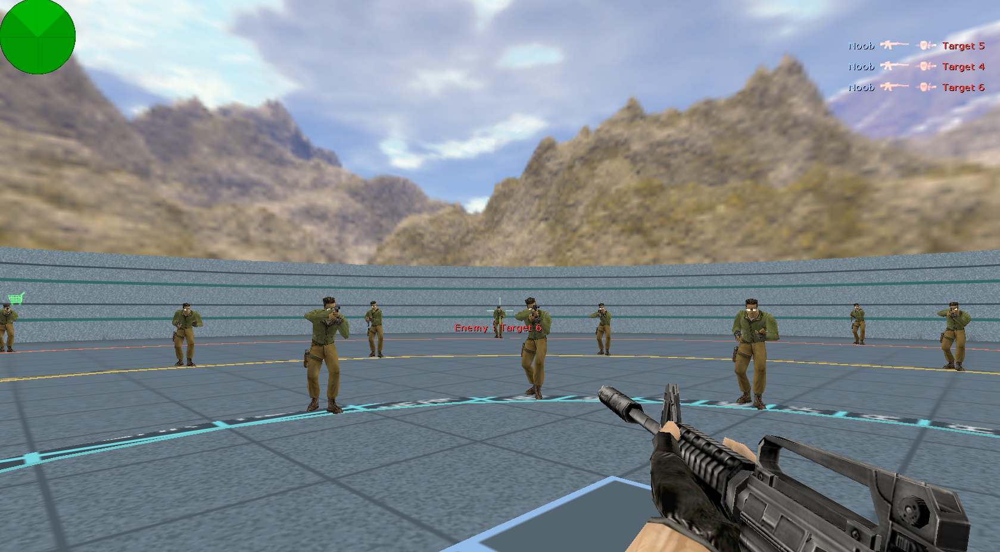
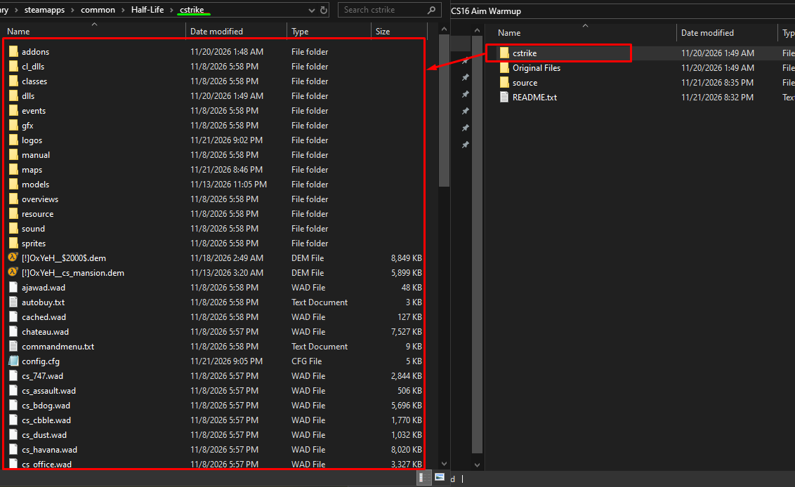
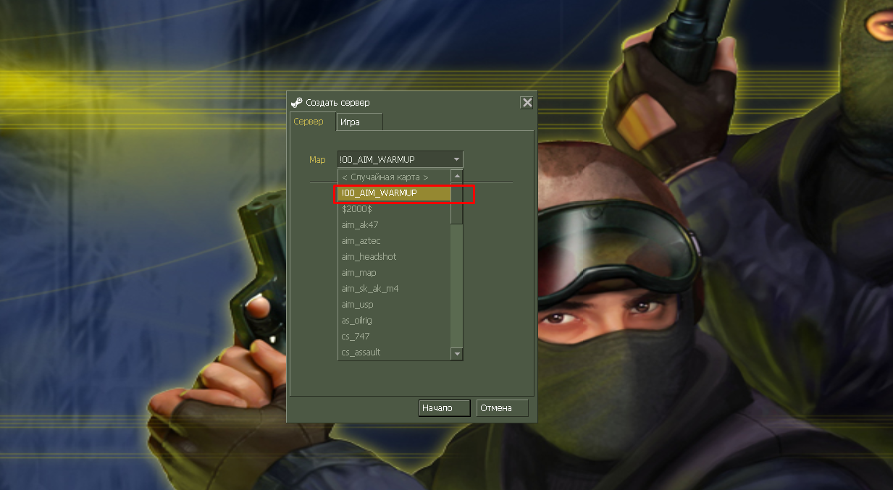
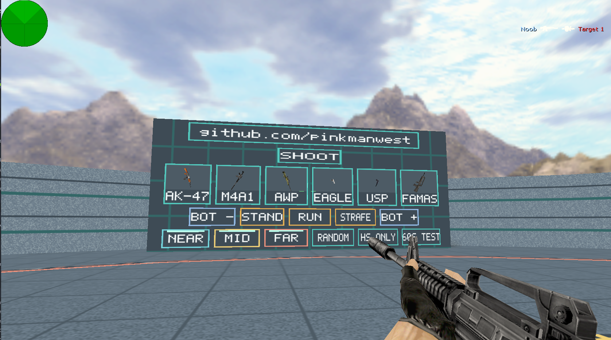
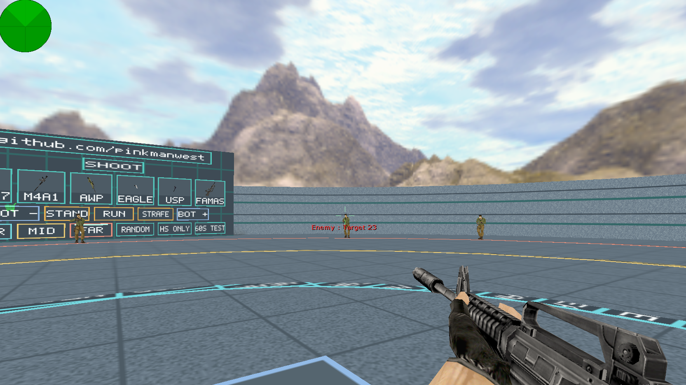

# CS 1.6 Aim Warmup

[Русский](README.md) · [English](README.en.md)

[Страница релиза и список файлов](https://github.com/pinkmanwest/cs16-warmup/releases/tag/v4.5) · [Как установить](#установка) · [Управление](#управление)

Круглая карта для разминки в Steam-версии Counter-Strike 1.6 на Windows. До 31 бота на трёх дистанциях, быстрые возрождения, бесконечные патроны и выбор оружия выстрелом. Запускается через «Новая игра» в самой CS 1.6.

## Установка

1. Нажми **Скачать ZIP для Windows** вверху страницы. Если открылась страница релиза, найди раздел **Assets** и выбери `CS16-Aim-Warmup-v4.5-Windows.zip`. Автоматические архивы `Source code` содержат исходники.
2. Закрой CS 1.6. В библиотеке Steam нажми правой кнопкой на **Counter-Strike** → **Управление** → **Просмотреть локальные файлы**. Откроется папка `Half-Life`, в которой уже есть `cstrike`.
3. Скопируй существующую папку `cstrike` в безопасное место. Резервная копия позволит вернуть игру в прежнее состояние.
4. Распакуй скачанный ZIP. Перенеси его папку `cstrike` в `Half-Life`, чтобы Windows объединила две папки `cstrike`. Если система спросит, выбери **Заменить файлы в папке назначения**. Итоговый путь к карте должен быть `Half-Life\cstrike\maps\!00_AIM_WARMUP.bsp`.
5. Запусти CS 1.6. Открой **Новая игра**, выбери `!00_AIM_WARMUP` и выставь **32 места**. Нажми **Начало** и выбери CT или T.

## Управление

В начале у тебя AK-47, USP и нож. Клавиша `2` открывает слот пистолета, `3` — нож. Выбери винтовку или пистолет на доске выстрелом либо подойди и нажми `E`. На выбор доступны AK-47, M4A1, AWP, Desert Eagle, USP и FAMAS. Патроны в магазине бесконечные. Меню смены команды открывается клавишей `M`.

| Кнопка на доске | Действие |
| --- | --- |
| `NEAR`, `MID`, `FAR` | Включают ближний, средний и дальний круги по отдельности. Подсветка показывает активные круги. |
| `BOT −` / `BOT +` | Убирают или добавляют одного бота в активных кругах. |
| `STAND` | Боты стоят на исходных позициях. |
| `RUN` | Боты бегут по кругам. |
| `STRAFE` | Боты двигаются в стороны, меняют направление и ненадолго останавливаются. |
| `RANDOM` | После смерти бот возрождается в случайной точке своего круга. |
| `HS ONLY` | Боты получают урон только от попаданий в голову. |
| `60S TEST` | Запускает личный минутный тест. В конце показывает убийства, хедшоты и точность. |

На карте нет стартовой заморозки. Таймер раунда начинается с 30 минут. Бот возрождается примерно через 0,3 секунды.

## Если что-то не работает

**Карты нет в списке.** Проверь, есть ли `!00_AIM_WARMUP.bsp` в `Half-Life\cstrike\maps`. Если в пути получилось `cstrike\cstrike`, перенеси файлы из внутренней папки на один уровень выше. Полностью перезапусти игру.

**Карта открылась, а ботов нет.** Убедись, что скопировал всю папку `cstrike` из готового ZIP, включая `addons` и `dlls`. Установи 32 места и проверь, что хотя бы одна кнопка круга подсвечивается.

**Хочу вернуться к исходной игре.** Закрой CS 1.6, переименуй изменённую папку `cstrike` и верни резервную копию под именем `cstrike`.

## Исходники и зависимости

В [source](source/) лежат исходник плагина Pawn, редактируемая карта GoldSrc и её WAD-текстуры. Для редактирования добавь `aim_warmup.wad` в настройки текстур Hammer. Текстуры уже встроены в игровой `.bsp`. Карта использует модели и небо из установленной CS 1.6.

Сборка использует AMX Mod X, Metamod-R и ReGameDLL_CS. Версии, лицензии и ссылки на исходники указаны в [THIRD-PARTY.md](THIRD-PARTY.md).

Проект [pinkmanwest](https://github.com/pinkmanwest).
